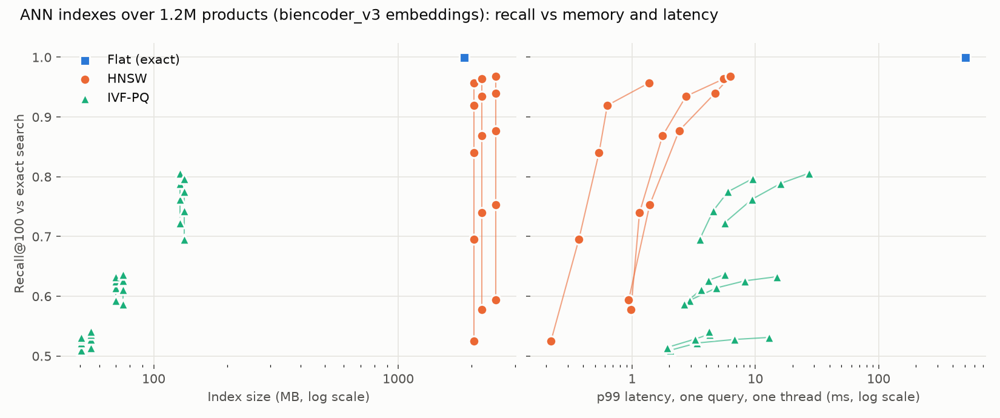

# ESCI Retrieval

[](https://github.com/Nova12007/esci-retrieval/actions/workflows/ci.yaml)

Dense retrieval over **1,215,854 Amazon products** from the Shopping Queries
(ESCI) dataset. A fine-tuned bi-encoder finds **7.4 points more of the
human-judged Exact products than BM25** in its top 100 (Recall@100 0.634 vs
0.560, paired 95% CI [+0.071, +0.077]), and the containerised service answers
at **p99 57 ms under 50 requests/s on 2 CPUs**, with every request missing
the cache.

Everything below is measured on the held-out test fold (22,458 queries) with
bootstrap confidence intervals, and every design decision has a written
record with its evidence in [`docs/decisions.MD`](docs/decisions.MD).

## Results

Test fold, 22,458 queries. 95% bootstrap CIs over queries are shown for the
headline column; every other cell's CI is within ±0.005 (`scripts/compare.py`
prints them all). Differences in the text are paired: same queries, both systems.

| system | Mode B Recall@100 | Mode B nDCG@10 | Mode A nDCG@10 | Mode A, unsaturated |
|---|---|---|---|---|
| BM25 (k1 1.2, b 0.75, untuned) | 0.560 [0.555, 0.565] | 0.320 | 0.751 | 0.538 |
| bge-small, zero-shot | 0.570 [0.566, 0.575] | 0.325 | 0.869 | 0.764 |
| **bge-small, fine-tuned (served)** | **0.634 [0.630, 0.639]** | **0.376** | **0.892** | **0.801** |
| RRF of BM25 + fine-tuned | 0.650 [0.645, 0.654] | 0.386 | 0.844 | 0.708 |
| fine-tuned → cross-encoder | 0.634 | 0.399 | 0.902 | 0.816 |
| RRF → cross-encoder (quality ceiling) | 0.650 | **0.404** | 0.902 | 0.816 |

- **Mode B** retrieves from all 1.2M products. **Mode A** reranks each query's
  judged products. Why both, and why Mode B is the headline: [evaluation](#evaluation).
- **Mode B nDCG@10** scores the order of what was retrieved, using judged gains;
  unjudged products count as 0, so like Recall@100 it is a lower bound.
- **Unsaturated** = queries with fewer than 10 Exact judgements (8,043), where
  Mode A can still tell systems apart.
- The cross-encoder rows are the quality ceiling, **not** the served system: it
  takes 7.4 s per query on CPU. The served path is the fine-tuned bi-encoder.

## Run it

Needs Docker. Builds the service from the published serving artifacts
(index, ONNX encoder, catalog: [huggingface.co/N0va12007/esci-retrieval-artifacts](https://huggingface.co/N0va12007/esci-retrieval-artifacts)),
so neither the dataset nor a GPU is required.

```bash
make docker                      # build and serve on :8000 at 2 CPUs / 4 GB
                                 # search page: http://localhost:8000
curl "http://localhost:8000/search?q=usb+c+cable+6ft&k=5"
make loadtest                    # k6, open loop, ramps to 50 requests/s
```

Each response carries per-stage timings; `/info` reports the model, index
settings, cache hit rate and batching stats.

Training and evaluation (needs the ESCI parquet files and a CUDA GPU; trained
on a 6 GB RTX 4050 laptop):

```bash
uv sync && make data && make bm25 corpus=tbb   # data pipeline + BM25 baseline
uv run python scripts/train_biencoder.py --epochs 2 --out artifacts/biencoder_v3
uv run python scripts/run_dense.py --name biencoder_v3 --checkpoint artifacts/biencoder_v3/final.pt
uv run python scripts/compare.py --baseline bm25_tbb --systems biencoder_v3
make check                                 # ruff, mypy --strict, pytest
```

## How it works

```
offline                                        per request (CPU, 2 vCPU)
───────                                        ─────────────────────────
ESCI judgements ─► query-centric examples      query
  1.26M pairs       S/C/I as hard negatives      │ LRU cache (top 100 per query)
                         │                       ▼
           bge-small + relevance-masked        ONNX fp32 encoder ......... ~8 ms
           InfoNCE, hand-written loop            │ opportunistic batches of 8
                         │                       ▼
          encode 1.2M products ─► HNSW ───────► HNSW, M=16, efSearch=256 .. ~1.6 ms
                                   (2.0 GB)      │
                                                 ▼
          product titles ─► SQLite ──────────► hydrate top k ............. ~1 ms
```

- **Model:** `BAAI/bge-small-en-v1.5`, fine-tuned 2 epochs on the 67,494
  training queries, batch 64 queries with gradient checkpointing on a 6 GB GPU.
- **Training data:** one example per query, not per (query, product) pair.
  95.7% of training queries have several Exact products, so per-pair rows put the same
  query in a batch several times and trained its correct answers as negatives.
  The human-labelled Substitutes and Complements are the hard negatives.
- **Serving:** query encoding exported to ONNX (parity with PyTorch to
  2.6e-7), HNSW chosen from a 40-configuration index sweep, titles from SQLite rather
  than a 1.2M-entry dict in memory. The image carries no training dependencies.

## Evaluation

**Two modes, never blended.** ESCI judges a median of 16 products per
query, not the catalogue. Mode B (full-corpus Recall@100) therefore counts
only judged Exact products and is a *lower bound*: an unjudged product the
system returns is unknown, not wrong. Mode A (rerank the judged set) is
exact but saturates here: the median query has 13 Exact products among 16
judged, and BM25 already scores a perfect 1.0 on 30.6% of queries. Mode A is
reported overall and on the unsaturated slice, where gaps roughly double;
Mode B is the headline.

**Uncertainty on every comparison.** Percentile bootstrap CIs over queries,
paired differences, and a sign-flip permutation test (nDCG and recall are
bounded and skewed, so no t-test). With 22k queries almost everything is
significant; the write-ups judge effect size.

**Guards.**
- Splits by `query_id` hash (`hashlib`, stable across runs); a test asserts no
  query crosses folds.
- Metrics written by hand and tested against worked examples.
- A regression test in CI pins the zero-shot pipeline's score on a committed
  fixture. A floor was rejected after measuring that dropping the bge query
  prefix *raised* the fixture score: a pinned value catches drift either way.
- The evaluation refuses to search product vectors with a different model's
  query encoder, after that mistake once produced a plausible wrong number.

## What the experiments found

Each row changes one thing in the served model's recipe and is paired against
it (Mode B Recall@100 unless stated):

| change | effect | record |
|---|---|---|
| 16 queries per batch instead of 64 (same step count) | -0.0070 [-0.0080, -0.0059] | ADR-007 |
| stop treating Substitutes as negatives | **-0.0243** [-0.0259, -0.0228] | ADR-008 |
| model-mined negatives instead of the human labels | -0.0095 [-0.0117, -0.0075] | ADR-010 |
| human labels **plus** mined negatives | +0.0035, but Mode A unsaturated -0.0182 | ADR-010 |
| distil the cross-encoder, margin-MSE weight 1.0 | **-0.0391** | ADR-015 |
| distil the cross-encoder, weight 0.1 | -0.0075; Mode A unsaturated +0.0029 | ADR-015 |
| INT8 query encoder (3,000-query sample) | -0.0054 for ~2x faster encoding | ADR-016 |

1. **The human-labelled near-misses are the most valuable negatives in the
   data.** Removing Substitutes cost 2.4 points, 3.5x what a 4x larger batch
   gained. Mining negatives from the model's own retrievals lost to them: 98%
   of mined negatives were never judged, and recall fell even on queries
   that had no labelled negatives to lose, which points at unjudged correct
   answers being trained as wrong.
2. **The cross-encoder's gain did not distil into the bi-encoder.** The teacher
   only scored judged pairs, so it can teach "Exact against its near-misses"
   but not "Exact against the other 1.2M products", which is what retrieval
   needs. The student matched the teacher's margins (correlation 0.69 to 0.78)
   and still lost recall. Recorded as a negative result.
3. **BM25 still adds recall** (+1.5 points through RRF), most per query on
   queries that name a brand (+2.9). Read by hand, the dense model's worst
   failures are unfamiliar strings: rare brands, misspellings, codes
   ("arteckin" retrieves Artesian water); see the
   [failure analysis](docs/failure_analysis.md).

## Serving and performance

Load test (`loadtest/search.js`, k6, open loop: arrivals do not wait for
responses, so queueing shows in the tail) on the image from `make docker`,
2 CPUs / 4 GB, 22,458 unique queries so every request misses the cache:

| requests | failed | p50 | p95 | p99 at 50 req/s |
|---|---|---|---|---|
| 10,649 | 0% | 11.9 ms | 19.7 ms | **57.0 ms** |



- **Index:** HNSW keeps 95.7% of exact search's top 100 at 1.4 ms p99. IVF-PQ is
  16x smaller but loses 5-9 points of judged recall, more than fine-tuning
  gained; memory is not the binding constraint, so it was rejected.
- **Query encoder:** ONNX fp32 is ~1.5x faster than PyTorch with identical
  results. INT8 is ~2x faster again but costs half a point of recall for a few
  milliseconds inside a 100 ms budget, so it was not shipped.
- **Batching:** encoding whatever requests are already queued, with no timer,
  raised capacity ~50% (to ~250 queries/s per instance) with no added latency
  when idle. A timed window cost a lone request 10 ms on Windows' timer.

Full numbers: [`benchmarks/latency_report.md`](benchmarks/latency_report.md),
[`benchmarks/index_sweep.md`](benchmarks/index_sweep.md),
[`benchmarks/slices.md`](benchmarks/slices.md).

## Limitations

1. **Recall is a lower bound and per-query scores are noisy.** ESCI judges
   ~16 products per query; a system returning different correct products is
   scored as wrong. About a third of the worst cases read by hand were judging
   artefacts, not model errors.
2. **No live traffic.** The service is containerised and load-tested but not
   hosted; the interleaving study simulates clicks from labels, so it shows the
   method agreeing with offline metrics, not user behaviour.
3. **Small model, small budget.** A 33M-parameter encoder trained on a laptop
   GPU. The cross-encoder shows ~2.9 points of nDCG@10 left on the table that
   this work did not recover at serving cost.

## Repository

| path | contents |
|---|---|
| `src/esci/data/` | loading, query-level splits, query-centric examples, collation |
| `src/esci/training/` | hand-written loops, masked InfoNCE, margin-MSE, mining |
| `src/esci/models/` | bi-encoder, cross-encoder, shared encoder config |
| `src/esci/index/` | BM25, dense (FAISS and GPU exact search), HNSW / IVF-PQ, RRF, reranking |
| `src/esci/eval/` | metrics, bootstrap and permutation tests, slices, interleaving |
| `src/esci/serving/` | FastAPI app, engine, ONNX encoder, micro-batcher, catalog |
| `scripts/` | training, evaluation, sweeps, export, artifact build |
| `docs/decisions.MD` | 17 decision records with the evidence behind each |
| `docs/failure_analysis.md` | 20 worst dense-vs-BM25 queries, read by hand |
| `benchmarks/` | results log, latency, index sweep, slices, interleaving |
